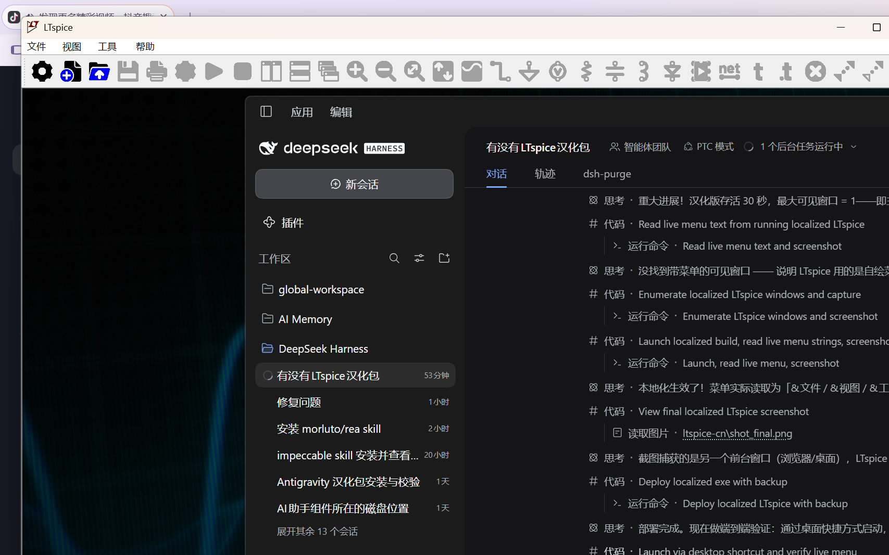

# LTspice 26.x 汉化

把 Analog Devices LTspice 26.x 的界面（菜单 / 右键菜单 / 工具栏 / 对话框 / 字符串表）换成简体中文。
给 agent 一键部署，也给人手动部署。**不改动任何可执行代码**，只替换 PE 资源段里的界面文本。

> 全网目前没有可直接使用的 LTspice 26.x 汉化包。GitHub 上 `ltspice chinese` / `ltspice 汉化` /
> `ltspice localization` 检索结果为 0 个；论坛里唯一在做的汉化只覆盖 26.0.2 且走网盘。
> 所以这里直接从 exe 资源做，词条是逐条人工校对的专业术语（拒绝机翻黑话，例如
> "Place a bus tap" → "放置总线分支"，而不是机翻的"刷公交卡"）。

## 一、给 agent 的部署指令

把这段话直接丢给 agent（Claude Code / Codex / Cursor / DSH 等能跑命令的）：

```
在本机安装 LTspice 26.x 汉化：
1. git clone https://github.com/spdw666/LTspice-26.x-zh 到工作区
2. 运行 python tools/apply_patch.py --patch patches/ltspice-26.1.1-zh.patch.json \
     --exe "<LTspice 安装目录>\LTspice.exe" --backup --restore
   (LTspice 默认安装在 %LOCALAPPDATA%\Programs\ADI\LTspice 或 C:\Program Files\ADI\LTspice)
3. 确认输出里 "替换 N/N 处" 且 "未定位 0 处"
4. 启动 LTspice 截图确认菜单是中文
5. 不要用 LTspice 自带更新器覆盖主程序
```

依赖只有 `pip install pefile`，Python 3.8+，Windows。整个补丁 200 KB。

## 二、手动部署（三步）

```powershell
pip install pefile
git clone https://github.com/spdw666/LTspice-26.x-zh; cd LTspice-26.x-zh

# 1) 备份原件 + 打补丁（--restore 会先还原再打，可重复执行）
python tools/apply_patch.py --patch patches/ltspice-26.1.1-zh.patch.json ^
    --exe "C:\Program Files\ADI\LTspice\LTspice.exe" --backup --restore

# 2) 启动确认
& "C:\Program Files\ADI\LTspice\LTspice.exe"

# 3) 还原英文（随时）
Copy-Item "C:\Program Files\ADI\LTspice\LTspice.exe.orig.bak" ^
          "C:\Program Files\ADI\LTspice\LTspice.exe" -Force
```

补丁按**原文文本**匹配，不依赖绝对偏移：同一大版本的另一小版本（26.1.2 等）
也能直接套用，定位不到的条目会被跳过并计数，不会写坏文件。换大版本（26.2 / 27）时用
`tools/scan_slots.py` 重新扫描基准，再 `tools/make_patch.py` 重出补丁即可。

## 三、覆盖范围

| 资源 | 数量 | 说明 |
|---|---|---|
| 菜单模板 RT_MENU | 17 个 / 1031 条 | 主菜单、全部右键菜单、工具栏下拉 |
| 对话框 RT_DIALOG | 130 个 / 1096 条 | 窗口标题、标签、按钮、复选框、提示语 |
| 字符串表 RT_STRING | 60 块 / 471 条 | 状态栏、工具提示、错误消息、文件类型过滤器 |
| **合计** | **2599 处** | 2920 个可译槽位中命中 2599 |

未翻译：`IDX_MRU_FILE1..16` 等内部键、`ASC/RAW/ASY/FFT` 等格式缩写，以及
`LTspiceHelp` 目录下的 752 个 HTML 帮助页（保持英文，避免破坏 CHM/索引）。

## 四、为什么是"等长替换"

LTspice 的资源加载器对每个条目的 **UTF-16 码元数**做边界校验：译文一短，后续结构
字段就会读到旧字符残渣，进程在启动 8 秒内直接退出（已实测复现）。

因此本项目的硬约束是：

- 菜单、字符串表：译文右侧**补空格**到与原文字符数完全相同（含 \`\t\` 的菜单项补在 \`\t\` 之前，
  避免污染快捷键列）；
- 对话框：文案本来就短，严格等长，超长自动跳过并保留英文。

结果：所有替换都是**原地等长字节写入**，PE 头、节表、资源目录、代码段零改动。

## 五、工具链

```
tools/scan_slots.py    扫描 exe 里的可翻译槽位 -> slots.json（需要 Windows，菜单靠 user32 读文本顺序）
tools/make_patch.py    slots.json + zh_dict.json + 原始 exe -> patch.json（200 KB）
tools/apply_patch.py   把 patch.json 应用到目标 exe（跨版本按文本匹配）
tools/dlg.py           DLGTEMPLATE / DLGTEMPLATEEX 解析器
patches/
  ltspice-26.1.1-zh.patch.json   2599 条替换
```

自己出补丁（换了版本、或想改词条）：

```powershell
# 用**原始英文 exe**扫基准（已汉化的 exe 扫出来是中文，不能当基准）
$env:LTSPICE_EXE = "C:\Program Files\ADI\LTspice\LTspice.exe.orig.bak"
$env:SLOTS_OUT   = "slots.json"
python tools/scan_slots.py

# 改完 zh_dict.json 后重出补丁
python tools/make_patch.py --slots slots.json --dict zh_dict.json ^
    --exe "C:\Program Files\ADI\LTspice\LTspice.exe.orig.bak" -o patches/ltspice-26.1.1-zh.patch.json
```

## 六、已在本机验证

- 打补丁产物 sha256 与手工构建的汉化版**完全一致**（`6bd0de08…`）
- `scan_slots.py` 扫出的 2920 个槽位与手工基准**逐条一致**（差异 0）
- 桌面快捷方式启动后进程存活，主窗口实时读回菜单文本：
  `&文件 / &视图 / &工具 / &帮助`，子项 `&新建原理图 Ctrl+N`、`&打开... Ctrl+O`、`退出`
- 17 个菜单资源全部可加载，项数与原始英文版逐一相同



## 七、已知限制

- 改过字节后 ADI 的 Authenticode 签名必然失效，脚本会主动摘除证书表目录项并重算 PE 校验和。
- 不要用 LTspice 自带的在线更新器覆盖主程序，会冲掉汉化；重新跑一次 `apply_patch.py` 即可恢复。
- 只覆盖 26.x 的 PE 资源。帮助文档（`LTspiceHelp\*.htm`）不在范围内。
- 术语如有异议，改 `zh_dict.json` 重出补丁，欢迎提 PR。

## 许可证

工具与词典用 MIT。LTspice 本体版权归 Analog Devices，本仓库不含任何 ADI 二进制文件，
只含文本补丁（原文 → 译文对照）与脚本。
